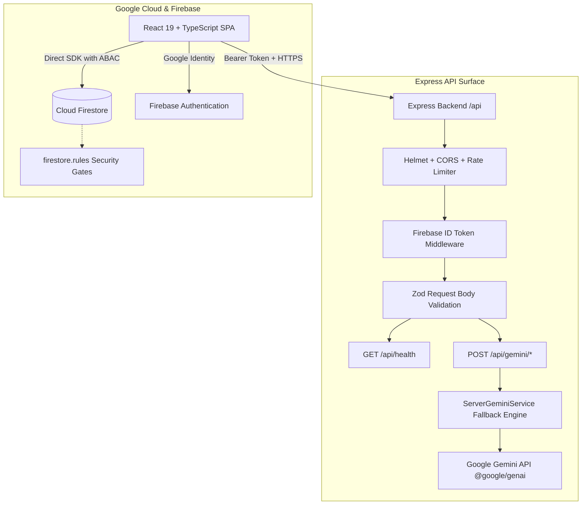
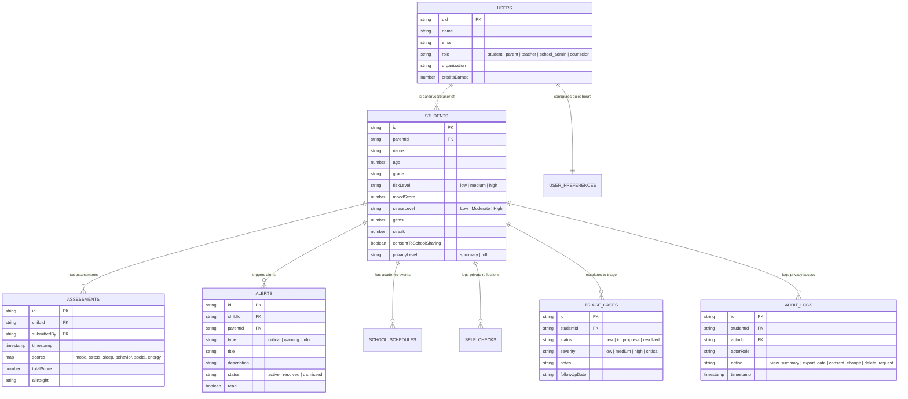

# Mind Bridge

> **Emotionally supportive wellbeing monitoring without making students feel clinically observed.**

Mind Bridge is an intelligent youth mental health and academic stress intelligence ecosystem. It integrates student self-reflection tools, longitudinal emotional pattern recognition, calendar stress clustering, and relationship-aware monitoring for **Students**, **Parents**, **Teachers**, **School Administrators**, and **Counselors**.

---

## 1. System Architecture



---

## 2. Roles & Permissions Matrix

Enforced centrally through `src/lib/permissions.ts` and hardened in `firestore.rules`:

| Capability / Resource | Student | Parent (`parent_of`) | Teacher (`teacher_of`) | Counselor | School Admin |
| :--- | :---: | :---: | :---: | :---: | :---: |
| **View Raw Diary / Self-Checks** | **YES** (Own only) | **NO** (Strictly Private) | **NO** | **NO** | **NO** |
| **View Wellbeing Summary / Trends** | **YES** | **YES** (Child only) | **YES** (Class cohort) | **YES** (Assigned) | **YES** (Aggregated) |
| **Receive Crisis & Stress Alerts** | **YES** | **YES** | **YES** | **YES** | **YES** |
| **Manage Counselor Triage Queue** | **NO** | **NO** | **NO** | **YES** | **YES** |
| **Update Clinical Session Notes** | **NO** | **NO** | **NO** | **YES** | **YES** |
| **Export Personal Data (GDPR/FERPA)**| **YES** | **YES** | **NO** | **NO** | **YES** |
| **Right to be Forgotten (Delete)** | **YES** | **YES** | **NO** | **NO** | **YES** |
| **Access Audit Log Trail** | **YES** | **YES** | **NO** | **YES** | **YES** |
| **System Admin Portal** | **NO** | **NO** | **NO** | **NO** | **YES** |

---

## 3. Full API Endpoint Reference

All protected endpoints require an `Authorization: Bearer <token>` header (Firebase ID token or synthetic test token in dev/demo mode) and return standardized JSON responses.

### Common Error Schema
When validation fails or an error occurs:
```json
{
  "error": {
    "code": "VALIDATION_ERROR" | "UNAUTHORIZED" | "RATE_LIMIT_EXCEEDED" | "INTERNAL_SERVER_ERROR",
    "message": "Human readable error description",
    "details": []
  }
}
```

---

### Endpoints

#### 1. `GET /api/health`
Health check endpoint used by uptime monitors and container load balancers.
- **Authentication**: Public (Unauthenticated)
- **Response `200 OK`**:
  ```json
  {
    "status": "ok",
    "uptime": 124.5,
    "timestamp": "2026-10-15T05:00:00.000Z",
    "service": "mind-bridge-backend",
    "version": "1.2.0"
  }
  ```
- **cURL Example**:
  ```bash
  curl -X GET http://localhost:3000/api/health
  ```

---

#### 2. `POST /api/gemini/insight`
Generates an executive clinical summary, concerns list, and 3 targeted recommendations for caretakers.
- **Authentication**: Bearer Token Required
- **Request Body**:
  ```json
  {
    "prompt": "Analyze child wellbeing metrics for Aarav (Age 15, mood: 7/10)"
  }
  ```
- **Response `200 OK`**:
  ```json
  {
    "status": "Student wellbeing telemetry is stable with balanced engagement.",
    "concerns": ["Routine academic monitoring advised."],
    "recommendations": [
      "Maintain regular sleep hygiene.",
      "Encourage open daily debriefs.",
      "Support physical relaxation breaks."
    ]
  }
  ```
- **Errors**: `400 VALIDATION_ERROR`, `401 UNAUTHORIZED`.
- **cURL Example**:
  ```bash
  curl -X POST http://localhost:3000/api/gemini/insight \
    -H "Authorization: Bearer test-token" \
    -H "Content-Type: application/json" \
    -d '{"prompt":"Analyze student wellbeing"}'
  ```

---

#### 3. `POST /api/gemini/pattern`
Detects repeating emotional cycles, statistical anomalies, and longitudinal trajectory shifts.
- **Authentication**: Bearer Token Required
- **Request Body**:
  ```json
  {
    "prompt": "Analyze 30-day assessment scores for recurring weekly stress patterns"
  }
  ```
- **Response `200 OK`**:
  ```json
  {
    "patterns": [
      {
        "type": "cyclical",
        "title": "Sunday Evening Academic Anticipation",
        "description": "Consistent dip in mood on Sunday evenings correlating with weekly deadline schedules.",
        "frequency": "Weekly",
        "impact": "negative",
        "confidence": 0.88
      }
    ],
    "anomalies": []
  }
  ```
- **cURL Example**:
  ```bash
  curl -X POST http://localhost:3000/api/gemini/pattern \
    -H "Authorization: Bearer test-token" \
    -H "Content-Type: application/json" \
    -d '{"prompt":"Historical telemetry records"}'
  ```

---

#### 4. `POST /api/gemini/predict`
Evaluates historical assessment trends against forward-looking calendar exams to forecast 7-day risk levels.
- **Authentication**: Bearer Token Required
- **Request Body**:
  ```json
  {
    "prompt": "Predict 7-day future risk based on upcoming exam schedule clustering"
  }
  ```
- **Response `200 OK`**:
  ```json
  {
    "predictedRisk": "low",
    "confidence": 85,
    "predictedTriggers": ["Upcoming physics midterm"],
    "preemptiveActions": ["Schedule 10-minute focus break blocks"],
    "evidence": ["Consistent sleep scores offsetting exam load"]
  }
  ```

---

#### 5. `POST /api/gemini/recommend`
Generates prioritized, age-appropriate micro-interventions with step-by-step instructions.
- **Authentication**: Bearer Token Required
- **Request Body**:
  ```json
  {
    "prompt": "Generate recommendations for high stress and low sleep"
  }
  ```
- **Response `200 OK`**:
  ```json
  {
    "recommendations": [
      {
        "type": "activity",
        "title": "Mindful 4-7-8 Breathing Reset",
        "description": "3-minute somatic regulation to reduce cortisol.",
        "priority": "high",
        "context": "Evening bedtime routine",
        "actionLabel": "Begin Session",
        "steps": [
          "Inhale quietly through nose for 4 seconds",
          "Hold breath for 7 seconds",
          "Exhale completely through mouth for 8 seconds"
        ]
      }
    ]
  }
  ```

---

#### 6. `POST /api/gemini/root-cause`
Performs multi-factor correlation across academic events, sleep debt, and social metrics.
- **Authentication**: Bearer Token Required
- **Request Body**: `{ "prompt": "Identify primary factor for recent mood dip" }`
- **Response `200 OK`**:
  ```json
  {
    "primaryFactor": "Academic Workload Clustering",
    "explanation": "Multiple high-weight assignments due within 48 hours is the primary driver of reported fatigue.",
    "confidence": 0.82
  }
  ```

---

#### 7. `POST /api/gemini/supportive-summary`
Generates non-clinical, empathetic prose tailored for student self-affirmation or parent review.
- **Authentication**: Bearer Token Required
- **Request Body**: `{ "prompt": "Supportive summary for student audience" }`
- **Response `200 OK`**: `{ "text": "You're navigating this week with admirable resilience. Remember to give yourself moments of rest." }`

---

#### 8. `POST /api/gemini/progressive-questions`
Generates stage-adapted assessment questions tailored to a student's longitudinal trajectory.
- **Authentication**: Bearer Token Required
- **Request Body**: `{ "prompt": "Generate 2 adaptive follow-up questions" }`
- **Response `200 OK`**:
  ```json
  [
    {
      "category": "resilience",
      "text": "When homework feels demanding, how confident do you feel taking a step back?",
      "options": [
        { "label": "Very confident and calm", "value": 1 },
        { "label": "Somewhat confident", "value": 2 },
        { "label": "A little overwhelmed", "value": 3 }
      ]
    }
  ]
  ```

---

#### 9. `POST /api/gemini/analyze-progressive-assessment`
Synthesizes student progressive assessment responses into overall risk tiers.
- **Authentication**: Bearer Token Required
- **Request Body**: `{ "prompt": "Synthesize progressive assessment answers" }`
- **Response `200 OK`**: `{ "summary": "Healthy coping patterns observed.", "riskTier": "low" }`

---

#### 10. `POST /api/gemini/parse-syllabus`
Parses academic course syllabi, assignments, and exam schedules from raw text or document attachments.
- **Authentication**: Bearer Token Required
- **Request Body**:
  ```json
  {
    "prompt": "Course syllabus: Midterm on Oct 20, Final Project due Nov 15"
  }
  ```
- **Response `200 OK`**:
  ```json
  {
    "events": [
      {
        "title": "Midterm Examination",
        "date": "2026-10-20",
        "subject": "General Academic",
        "type": "exam",
        "difficulty": "high"
      }
    ],
    "insights": ["High academic density detected between Oct 18 and Oct 20."]
  }
  ```

---

#### 11. `POST /api/gemini/analyze-emotion`
Extracts emotional mood ratings, stress levels, and safety escalation requirements from reflection text.
- **Authentication**: Bearer Token Required
- **Request Body**: `{ "prompt": "Check-in text: Feeling good about my project presentation" }`
- **Response `200 OK`**:
  ```json
  {
    "mood": 4,
    "stressLevel": "Low",
    "concerns": [],
    "supportiveMessage": "Great work! Celebrating small milestones builds lasting resilience."
  }
  ```

---

#### 12. `POST /api/gemini/analyze-assessment`
Analyzes multi-category score grids (`mood`, `stress`, `sleep`, `behavior`, `social`) and returns targeted guidance.
- **Authentication**: Bearer Token Required
- **Request Body**: `{ "prompt": "Multi-category score payload" }`
- **Response `200 OK`**:
  ```json
  {
    "primaryFactor": "Sleep Rhythm Stabilization",
    "recommendations": [
      "Establish consistent wind-down interval 30 minutes before bed.",
      "Encourage verbal reflection during morning debriefs."
    ]
  }
  ```

---

## 4. Firestore Database Schema & ER Diagram



### Firestore Collections & Access Rules

| Collection | Schema Path | Enforced Security Rule (`firestore.rules`) |
| :--- | :--- | :--- |
| `users` | `/users/{userId}` | Read: Self, Admin, or verified caretaker. Write: `isOwner(userId) \|\| isAdmin()`. |
| `students` | `/students/{studentId}` | Read: Self, Parent of child, Teacher, Counselor, Admin. Update: Parent, Self, Admin. Delete: Parent or Admin. |
| `assessments` | `/assessments/{assessmentId}` | Read: Student, Parent of child, Teacher, Counselor. Create: Authorized parent, student, or clinician. |
| `notifications` | `/notifications/{alertId}` | Read: Intended recipient (`parentId`, `childId`, or clinical staff). Write: Caretakers and staff only (no blanket writes). |
| `schoolSchedules` | `/schoolSchedules/{scheduleId}`| Read: Student, Parent, Teacher. Write: Parent, Teacher, or Admin. |
| `selfChecks` | `/selfChecks/{checkId}` | Read/Write: Student (own reflection) or verified parent. Never exposed to third parties. |
| `triageCases` | `/triageCases/{caseId}` | Read/Write: Counselors and School Admins only. |
| `auditLogs` | `/auditLogs/{logId}` | Read: Student, Actor, Admin. Create: System/Authenticated. Update/Delete: **Denied** (Immutable audit log). |
| `userPreferences` | `/userPreferences/{userId}` | Read/Write: Strictly owner-isolated (`isOwner(userId)`). |

---

## 5. The AI Processing & Resilience Pipeline

```
[Student Input / Assessment Scores]
               │
               ▼
   [1. NLP Sentiment Scoring] ──> Analyzes text for severe/growth keyword modifiers
               │
               ▼
   [2. Deterministic Rule Engine] ──> Checks sleep-stress coincidence & academic clustering
               │
               ▼
  [3. Central AI Orchestrator] ──> Server-side Gemini API call via /api/gemini/*
               │
               ├─► [Network/Quota OK] ──> Returns structured Gemini inference
               └─► [API Fails / 429]  ──> Triggers Resilient Fallback (UI Never Breaks)
               │
               ▼
  [4. Role-Aware Permission Filter] ──> Strips raw reflections before delivering to Parents/Teachers
               │
               ▼
     [Role-Specific UI View] ──> Rendered in Black/Neon futuristic dashboard
```

---

## 6. Security & Hardening Model

1. **Authentication Gate**: All backend `/api` routes (excluding `/api/health`) require valid Bearer tokens.
2. **Rate Limiting**: Throttles abuse to 120 requests per 15 minutes per IP address.
3. **Helmet Security Headers**: Enforces strict transport security, MIME sniffing protection, and XSS filtering.
4. **CORS Allowlist**: Explicitly restricts cross-origin resource sharing to trusted hosting domains and localhost.
5. **Request Body Size Limit**: Hard 2MB payload ceiling on incoming JSON to prevent denial of wallet attacks.
6. **Zod Validation**: Rejects malformed JSON bodies before executing controller or AI business logic.
7. **Firestore ABAC**: Strict attribute-based and relationship-based access control eliminates unauthorized database reads.

---

## 7. Setup & Environment Variables

Copy `.env.example` to `.env`:
```bash
cp .env.example .env
```

| Variable | Description | Required? |
| :--- | :--- | :---: |
| `GEMINI_API_KEY` | Google Gemini API Key for server-side inference | Yes (In production) |
| `PORT` | Express server port (Default: `3000`) | No |
| `NODE_ENV` | Environment mode (`development`, `production`, `test`) | No |
| `APP_URL` | Domain URL for CORS allowlist | No |

---

## 8. Deployment & Execution

```bash
# 1. Type check & Linting
npm run lint

# 2. Execute test suites
npx vitest run

# 3. Test coverage
npm run test:coverage

# 4. Production build
npm run build

# 5. Start production server
npm start
```

---

## 9. Product Roadmap

- [x] Multi-factor weighted assessment scoring and NLP text sentiment modifiers.
- [x] India default crisis escalation screen with Tele-MANAS (14416) helpline.
- [x] Student privacy and consent controls with machine-readable data export (GDPR).
- [x] Counselor clinical triage queue with notes and follow-up scheduling.
- [x] Notification center with Quiet Hours and emergency safety bypass.
- [x] 7-day longitudinal weekly wellbeing print/PDF report.
- [x] 5-Role persona simulation switcher in header.
- [ ] Offline local IndexedDB database sync for native Android & PWA deployment.
- [ ] Wearable biometric integration (heart rate variability and sleep tracking via Health Connect).
